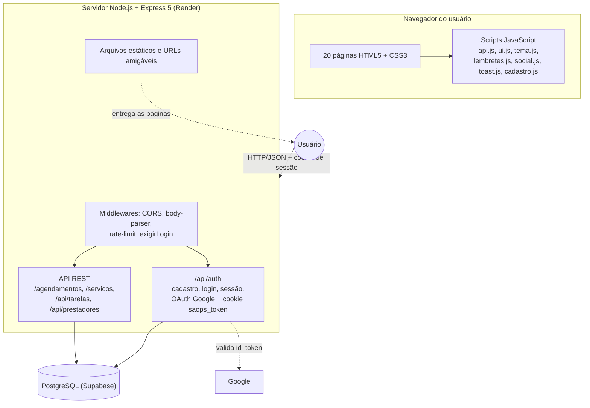
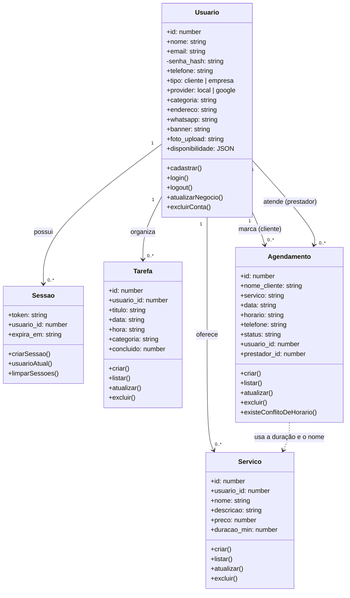
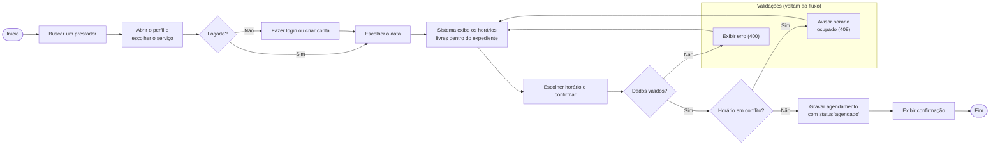
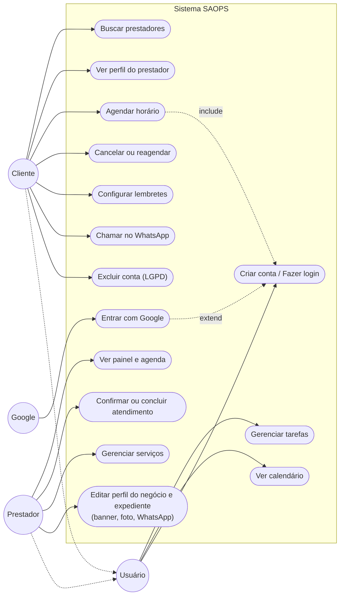
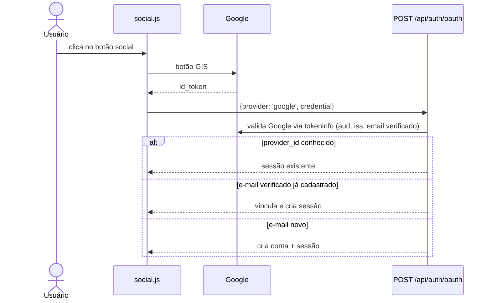
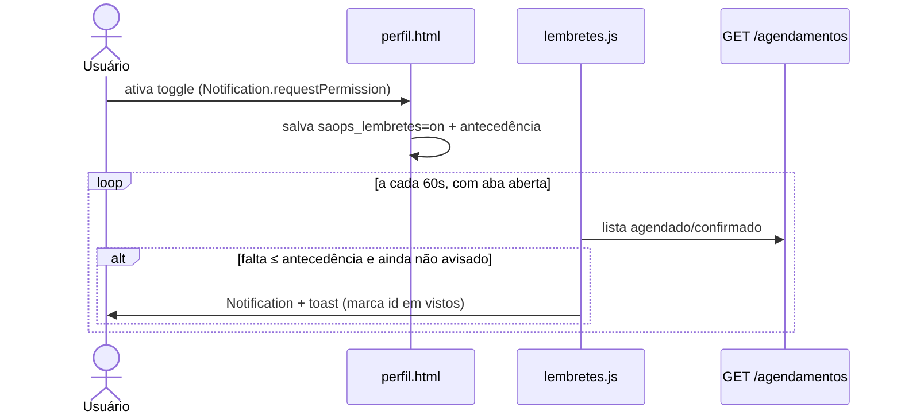
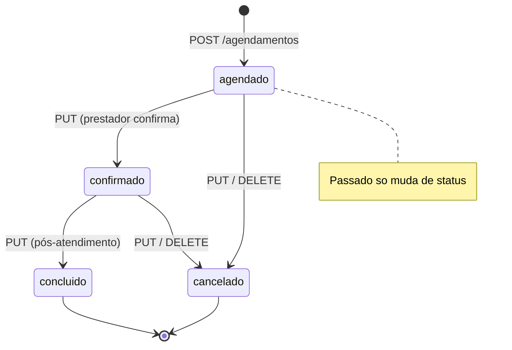
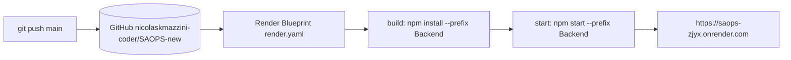
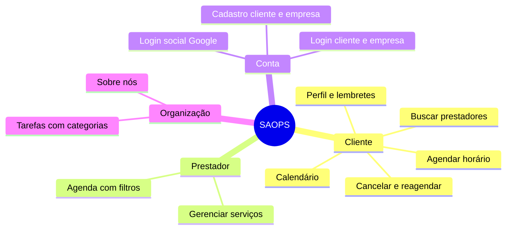

# 📊 Diagramas do SAOPS

Arquitetura em [Mermaid](https://mermaid.js.org/) (renderizam direto no GitHub).

---

## 1. Arquitetura de Software

---

## 2. Diagrama de Classes

---

## 3. Diagrama de atividade

---

## 4. Diagrama de caso de uso

---

## 5. Login social (Google)

---

## 6. Lembretes de agendamento

> Push em 2º plano (aba fechada) é o próximo passo: Service Worker + Web Push + scheduler no servidor.

---

## 7. Status do agendamento

---

## 8. Deploy

---

## 9. Mapa das páginas

---

*Gerado a partir do código em `Backend/` e `Frontend/` — se o código mudar, atualize os diagramas.*
